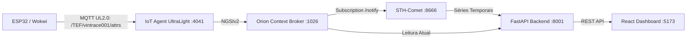
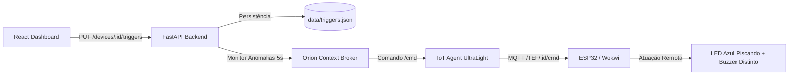

# VinTrace — Monitoramento Inteligente de Adegas

> Projeto Acadêmico CP5 · FIAP — Engenharia de Software · Edge Computing & FIWARE · 2026

O **VinTrace** é um sistema completo e integrado de monitoramento ambiental e proteção de vinhos finos. A arquitetura conecta hardware IoT físico (ESP32) e simulado (Wokwi), brokers de contexto FIWARE (Orion, IoT Agent UltraLight e STH-Comet), API de integração em FastAPI com avaliação em background e um dashboard web responsivo em React.

---

## 1. Arquitetura Integrada

### Fluxo de Telemetria


### Fluxo de Triggers e Alertas Remotos


---

## 2. Padrões do Contrato Técnico

| Item | Padrão | Observação |
|---|---|---|
| **Entity type** | `VinTrace` | Padronizado em todas as camadas |
| **Device ID** | `vintrace001` | Suporta múltiplos dispositivos dinâmicos |
| **Entity URN** | `urn:ngsi-ld:VinTrace:001` | Derivado consistentemente a partir do Device ID |
| **FIWARE Service** | `smart` | Configurado via `.env` |
| **FIWARE Service Path** | `/` | Configurado via `.env` |
| **API Key** | `TEF` | Configurado via `.env` |
| **Temperatura** | `t` -> `temperature` | Defaults: 10.0 a 18.0 °C |
| **Umidade** | `h` -> `humidity` | Defaults: 60.0 a 80.0% |
| **Luminosidade** | `l` -> `luminosity` | Defaults: 0.0 a 20.0% |
| **Comando alertTemp** | `alertTemp` | `on` / `off` |
| **Comando alertHum** | `alertHum` | `on` / `off` |
| **Comando alertLum** | `alertLum` | `on` / `off` |

---

## 3. Como Executar o Backend (FastAPI)

Requer Python 3.11+.

```bash
cd backend

# Criar e ativar ambiente virtual
python -m venv .venv
# Windows (PowerShell):
.\.venv\Scripts\Activate.ps1
# Linux / macOS:
# source .venv/bin/activate

# Instalar dependências
pip install -r requirements.txt

# Executar a API
uvicorn app.main:app --reload --port 8001
```

- Documentação Swagger da API: [http://localhost:8001/docs](http://localhost:8001/docs)
- Endpoint de saúde geral: `GET http://localhost:8001/health`
- Endpoint de saúde FIWARE: `GET http://localhost:8001/health/fiware`

---

## 4. Como Executar o Dashboard (React + Vite)

Requer Node.js 18+ e npm.

```bash
cd dashboard/frontend

# Instalar dependências
npm install

# Iniciar servidor de desenvolvimento
npm run dev
```

Acesse no navegador: [http://localhost:5173](http://localhost:5173).

Para validar build de produção:
```bash
npm run build
```

---

## 5. Provisionamento do Stack FIWARE

Caso esteja utilizando um stack local (Docker) ou instância EC2:

1. Configure as variáveis no `backend/.env`:
   - `FIWARE_BASE_URL` (Orion - default `http://localhost:1026`)
   - `IOT_AGENT_URL` (IoT Agent UltraLight - default `http://localhost:4041`)
   - `STH_COMET_URL` (STH-Comet - default `http://localhost:8666`)
   - `MQTT_HOST` (Mosquitto - default `localhost`)

2. Execute o provisionamento automatizado de Service Group, Subscription e Dispositivo:
```bash
python infrastructure/fiware/setup_fiware.py
```

---

## 6. Firmware ESP32 e Simulação Wokwi

### Hardware Físico (`firmware/vintrace.ino`)
- Sensor DHT11 no GPIO 4
- LDR no GPIO 34 (0-100%)
- LED Azul no GPIO 2
- Buzzer Passivo no GPIO 25 (GPIO 18 liberado para display TFT SPI)
- Copie `firmware/secrets.example.h` para `firmware/secrets.h` com as credenciais de rede Wi-Fi e broker MQTT.

### Simulação Wokwi (`wokwi/vintrace-simulation/`)
- ESP32 + DHT22 + LDR + LED Azul + Buzzer Passivo.
- Código ajustado com persistência de alerta visual e diferenciação sonora cíclica.
- Diagrama JSON pronto para importação direta no [Wokwi ESP32](https://wokwi.com/projects/new/esp32).

---

## 7. Status dos Testes de Aceitação

| Teste | Critério | Status |
|---|---|---|
| **Cadastro** | Cadastrar `vintrace001` pelo React e registrar no IoT Agent/Orion | **IMPLEMENTADO & TESTADO** |
| **Telemetria** | ESP32 envia `t/h/l` no padrão UltraLight `/TEF/vintrace001/attrs` | **IMPLEMENTADO** |
| **Histórico** | STH-Comet retorna séries temporais pela porta 8666 | **IMPLEMENTADO & CONECTADO** |
| **Gráficos** | Dashboard consome `/history?period=24h\|7d\|30d` sem mocks silenciosos | **IMPLEMENTADO & CONECTADO** |
| **Triggers** | Edição de limites no frontend e persistência no `data/triggers.json` | **IMPLEMENTADO & TESTADO** |
| **Temperatura** | Anomalia remota dispara comando `alertTemp=on` -> LED pisca + tom 1800Hz | **IMPLEMENTADO** |
| **Umidade** | Anomalia remota dispara comando `alertHum=on` -> LED pisca + tom 1200Hz | **IMPLEMENTADO** |
| **Luminosidade** | Anomalia remota dispara comando `alertLum=on` -> LED pisca + tom 800Hz | **IMPLEMENTADO** |
| **Normalização** | Retorno aos limites dispara comando `off` e silencia atuadores | **IMPLEMENTADO** |
| **Múltiplos Alertas** | Dois parâmetros simultâneos ciclam os tons sem se anular | **IMPLEMENTADO** |
| **Wine Memory** | Passaporte ambiental calculado a partir dos pontos reais do STH-Comet | **IMPLEMENTADO & TESTADO** |
| **Exclusão** | Exclusão de dispositivo limpa IoT Agent, Orion e triggers | **IMPLEMENTADO & TESTADO** |
| **Hands-on Físico** | Validação no protótipo físico com a banca | **PENDENTE DE VALIDAÇÃO PRESENCIAL** |

---

## 8. Equipe

Integrantes e RMs disponíveis em [`docs/equipe.md`](docs/equipe.md).
Site de apresentação e landing page: [`site/index.html`](site/index.html).
